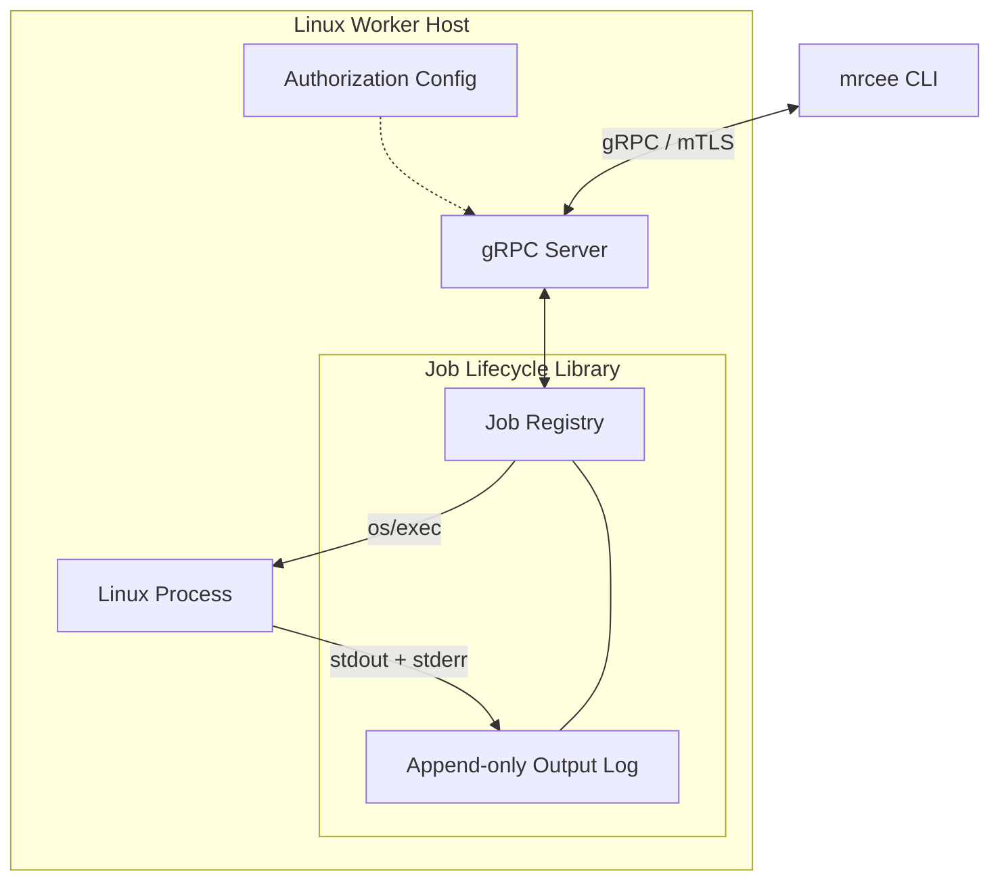
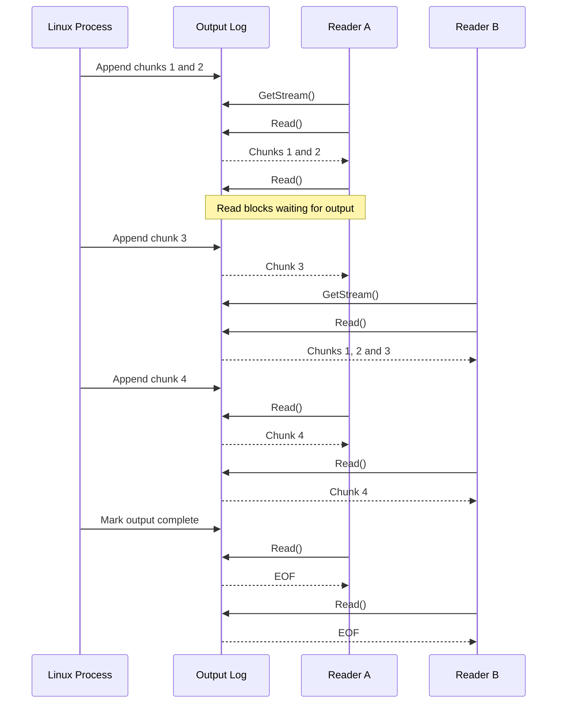

# Design document

## Design Approach

`mrcee` consists of three loosely coupled components:

1. **Job lifecycle library**: an importable Go library that is responsible for starting, monitoring and stopping Linux processes. Independant of the transport layer.
2. **Server**: a gRPC server that accepts client requests to handle the job operations, authentication and authorization.
3. **`mrcee` CLI**: an client implementation for communicating with the server - submitting jobs, inspecting their state, streaming their output, handling cancellations.

Jobs will execute asynchronously and independently of client connections. The job lifecycle library will manage execution state and retain output from the start of execution, allowing multiple clients to independently observe the same job, including its historical output.

Job metadata, process runtime state and output storage will be kept logically separate to support future persistence and distributed execution.

### Architecture diagram

## Scope

The service will support asynchronous execution of non-interactive programs with command-line arguments, job status tracking, termination, and binary-safe stdout/stderr streaming. Multiple concurrent clients will be able to independently stream a job's output from the beginning of its execution, including output produced before they subscribed.

The gRPC API will provide these operations using mTLS authentication and a simple role-based authorization scheme.

The following items are out of scope:
* Guaranteed termination of child processes and per-job resource controls using cgroups.
* Interactive programs requiring stdin or a terminal.
* Persistence of jobs and their output across server restarts.
* Automated certificate issuance and renewal.
* High Availability // distributed execution across multiple worker hosts.

## Proposed API

The service will have 4 gRPC methods for:
* Starting the job
* Query job status
* Cancelling the job
* Getting job's output.

For full spec, see [mrcee.proto](proto/mrcee.proto)

## Security considerations

### Transport Security & Authentication

All gRPC communication will use mTLS with TLS 1.3. Cipher suite negotiation will be delegated to Go's secure TLS 1.3 implementation, supporting AES-GCM and ChaCha20-Poly1305.

For local development, a Go utility will generate a private CA and ECDSA P-256 certificates for the server and clients. Certificates will use appropriate Subject Alternative Names (DNS/IP for the server, URI identities for clients) and Extended Key Usages (serverAuth and clientAuth respectively).

Generated credentials will be excluded from version control, with private keys stored using restricted filesystem permissions. The server will require and verify client certificates, while clients will verify the server's certificate and identity.

In production, certificate issuance, renewal and revocation would be delegated to a dedicated PKI service.

### Authorization

A simple role-based authorization scheme will be used, with client identities mapped to roles in server-side configuration.

**Viewer**: Can query job status and fetch/stream output.

**Operator**: Viewer permissions + start and stop jobs.

Jobs will use UUIDv4 identifiers to discourage enumeration. However, knowledge of a job ID does not bypass authorization.

### Process Isolation

Jobs will execute under the worker service's Linux user. While API authorization protects access to service operations, it does not provide isolation between executing processes or protect the host from malicious authorized operators.

Stronger isolation through separate OS identities, namespaces or containers would be required for a multi-tenant deployment, but is outside of the scope.

## CLI UX

The CLI has commands, and full and shorthand flags (e.g. `--follow` and `-f`). The aim is for commands to be short, clear, and intuitive for users of GNU/Linux tools.

Interrupting a command (CTRL+C) will not stop the underlying command.

Optional flags `--server` `--cert` and `--key` will exist with sensible defaults defined for them.

For usage examples - see [Usage Examples](../README.md#usage-examples) in README.

## Implementation details

### Go & Tooling

The implementation will follow idiomatic Go practices, favouring simplicity and the standard library over unnecessary dependencies and abstractions. Code will follow the conventions described in Effective Go.

**CLI**: `urfave/cli` for commands, flags, shorthand aliases and help generation.

**gRPC**: `google.golang.org/grpc`, with `protoc`, `protoc-gen-go` and `protoc-gen-go-grpc` for code generation.

**Process execution**: Go's os/exec package.

Testing: Standard testing package + `stretchr/testify` for convenience functions.

### Job Lifecycle

Jobs will be managed using standard library's `os/exec`, executing programs directly. Each job will have an independent lifecycle, with execution monitored asynchronously.

Job metadata will be stored and managed in an in-memory, concurrency-safe job registry.

Stopping a job will terminate its main process and wait for it to exit. Comprehensive child-process termination is out of scope.

### Output Streaming

Process `stdout` and `stderr` streams will be merged into a single, binary-safe output stream using a shared `io.Writer`.

Output will be stored in an append-only, in-memory buffer from the beginning of process execution. Each subscriber will maintain an independent read offset, allowing historical replay and concurrent streaming.

New output will notify subscribers through Go synchronization primitives, avoiding polling. gRPC subscribers will read from the aforementioned output.

Job's output requests will be categorized in two categories, _non-following_ and _following_. Former will return the currently available output, while latter will continue streaming until the job completes and all captured output has been delivered.

#### Output Streaming (following) - flow chart

