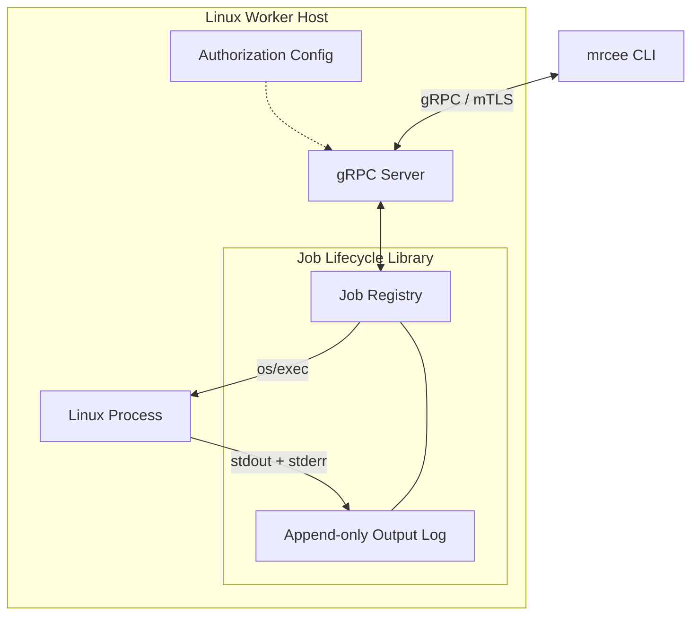
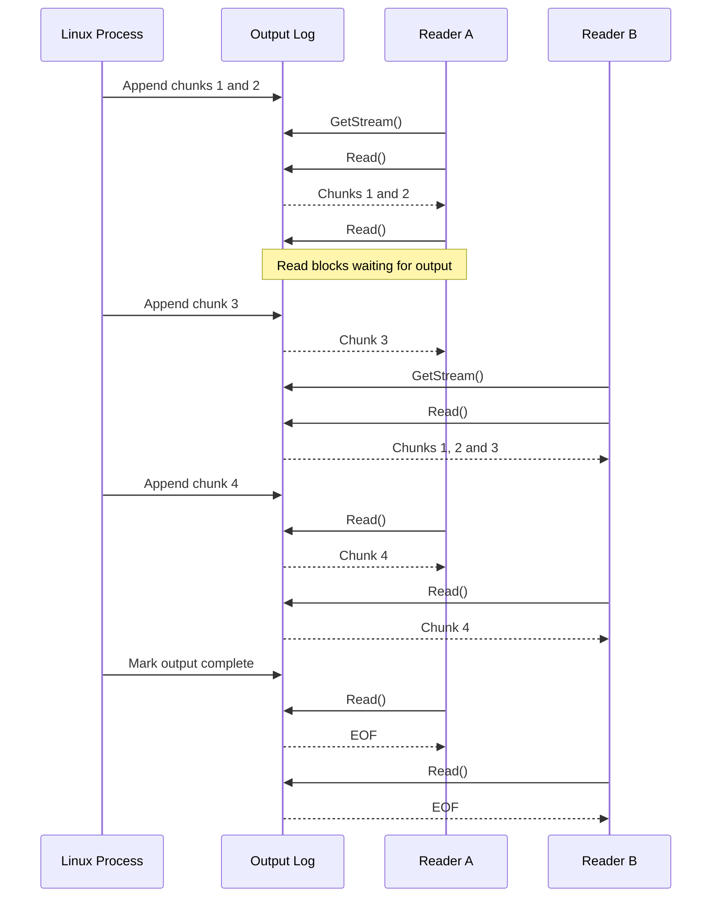

# Design document

## Design Approach

`mrcee` consists of three loosely coupled components:

1. **Job lifecycle library**: an importable Go library that is responsible for starting, monitoring and stopping Linux processes. Independant of the transport layer.
2. **Server**: a gRPC server that accepts client requests to handle the job operations, authentication and authorization.
3. **`mrcee` CLI**: an client implementation for communicating with the server - submitting jobs, inspecting their state, streaming their output, handling cancellations.

Jobs will execute asynchronously and independently of client connections. The job lifecycle library will manage execution state and retain output from the start of execution, allowing multiple clients to independently observe the same job, including its historical output.

Job metadata, process runtime state and output storage will be kept logically separate to support future persistence and distributed execution.

### Architecture diagram



## Scope

The service will support asynchronous execution of non-interactive programs with command-line arguments, job status tracking, termination, and binary-safe stdout/stderr streaming. Multiple concurrent clients will be able to independently stream a job's output from the beginning of its execution, including output produced before they subscribed.

The gRPC API will provide these operations using mTLS authentication and a simple role-based authorization scheme.

The following items are out of scope:
* Guaranteed termination of child processes and per-job resource controls using cgroups.
* Interactive programs requiring stdin or a terminal.
* Persistence of jobs and their output across server restarts.
* Automated certificate issuance and renewal.
* High Availability // distributed execution across multiple worker hosts.

## Proposed API

The service will have 4 gRPC methods for:
* Starting the job
* Query job status
* Cancelling the job
* Getting job's output.

For full spec, see [mrcee.proto](proto/mrcee.proto)

## Security considerations

### Transport Security & Authentication

All gRPC communication will use mTLS with TLS 1.3. Cipher suite negotiation will be delegated to Go's secure TLS 1.3 implementation, supporting AES-GCM and ChaCha20-Poly1305.

For local development, a Go utility will generate a private CA and ECDSA P-256 certificates for the server and clients. Certificates will use appropriate Subject Alternative Names (DNS/IP for the server, URI identities for clients) and Extended Key Usages (serverAuth and clientAuth respectively).

Generated credentials will be excluded from version control, with private keys stored using restricted filesystem permissions. The server will require and verify client certificates, while clients will verify the server's certificate and identity.

In production, certificate issuance, renewal and revocation would be delegated to a dedicated PKI service.

### Authorization

A simple role-based authorization scheme will be used, with client identities mapped to roles in server-side configuration.

**Viewer**: Can query job status and fetch/stream output.

**Operator**: Viewer permissions + start and stop jobs.

User identities will be extraced from the users' verified mTLS certificates. A static server-side configuration (YAML file) will map these identities to either `viewer` or `operator` roles. This mapping will be loaded at server startup and enforced in the gRPC layer.

As a basic precaution against users modifying the role bindings and giving other users privilege escalation by executing commands, the static configuration could be owned by `root`, with permissions `0640`, allowing server's underlying Linux user to only read the file. In a production environment it'd be important to ensure a stronger OS-level separation to provide complete isolation between executed processes and API server.

Jobs will use UUIDv4 identifiers to discourage enumeration. However, knowledge of a job ID does not bypass authorization.

### Process Isolation

Jobs will execute under the worker service's Linux user. While API authorization protects access to service operations, it does not provide isolation between executing processes or protect the host from malicious authorized operators.

Stronger isolation through separate OS identities, namespaces or containers would be required for a multi-tenant deployment, but is outside of the scope.

## CLI UX

The CLI has commands, and full and shorthand flags (e.g. `--follow` and `-f`). The aim is for commands to be short, clear, and intuitive for users of GNU/Linux tools.

Interrupting a command (CTRL+C) will not stop the underlying command.

Optional flags `--server` `--cert` and `--key` will exist with sensible defaults defined for them.

For usage examples - see [Usage Examples](../README.md#usage-examples) in README.

### Supported Commands

The worker will support non-interactive Linux executables available on the server's system.

Some examples:
```bash
# Simple command
mrcee start -- echo "Hello World"

# Command with arguments
mrcee start -- find /tmp -type f

# Long-running command
mrcee start -- sleep 120

# Continuous output
mrcee start -f -- tail -f error.log

# Binary output
mrcee start -f -- head -c 1024 /dev/urandom

# Invoked shell script with redirections
mrcee start -- sh -c 'echo "Something failed" >&2; exit 42'

# Invoked shells cript with pipes
mrcee start -- sh -c 'echo "hello" | wc -c'
```

### Unsupported commands

* Interactive applications requiring stdin or a terminal (PTY), such as `vim`, `top`, `k9s`.
* Implicit shell interpretation: Shell features such as pipes, redirects, variable expansion and globbing require explicitly invoking a shell (sh -c '...'), a command like `mrcee start -- echo "hello" '|' wc -c` would not have the pipeline constructed. 

## Implementation details

### Go & Tooling

The implementation will follow idiomatic Go practices, favouring simplicity and the standard library over unnecessary dependencies and abstractions. Code will follow the conventions described in Effective Go.

**CLI**: `urfave/cli` for commands, flags, shorthand aliases and help generation.

**gRPC**: `google.golang.org/grpc`, with `protoc`, `protoc-gen-go` and `protoc-gen-go-grpc` for code generation.

**Testing**: Standard testing package + `stretchr/testify` for convenience functions.

### Job Lifecycle

Jobs will be managed using standard library's `os/exec`, executing programs directly. Each job will have an independent lifecycle, with execution monitored asynchronously.

Job metadata will be stored and managed in an in-memory, concurrency-safe job registry.

Stopping a job will synchronously terminate its main process by sending a `SIGTERM` with a grace period of 10 seconds. Afterwards, if the job did not stop, a `SIGKILL` will be sent. A response from `StopJob` returns `JobStatus`, which is guaranteed to include an `exit_code` or a `termination_signal`, depending on whether the process was terminated by a signal or handled the signal and exited. It would also have a `finished_at` timestamp which would allow to determine the execution duration. 

Comprehensive child-process termination is out of scope. If the parent process spawned some child processes, there is no guarantee those will have stopped when parent process has.

### Output Streaming

Process `stdout` and `stderr` streams will be merged into a single, binary-safe output stream using a shared `io.Writer`.

Output will be stored in an append-only, in-memory buffer from the beginning of process execution. Each subscriber will maintain an independent read offset, allowing historical replay and concurrent streaming.

New output will be stored in an append-only `[]byte` buffer, with `sync.Mutex` synchronizing reads and writes. Library will expose the output stream as `io.ReadCloser`, so the users will be iteratively calling `Read()`, which will return up to the caller's buffer capacity from the available output, blocking only when no unread data is available and the job is still running.

In the library, a broadcast channel pattern will be used. When a reader reaches the end of available output, it will block on `select` statement as in the code snippet below. 

```go
select {
case <-changed: // output changed, recheck buffer and completion state
case <-ctx.Done():
    return 0, ctx.Err()
case <-reader.closed:
    return 0, io.ErrClosedPipe
}
```

Whenever new output is appended, the library will close the broadcast channel to wake all waiting readers, then replace it with a new channel for subsequent notifications. Example: 
```go
func (b *Buffer) Append(data []byte) {
    b.mu.Lock()
    defer b.mu.Unlock()

    b.data = append(b.data, data...)

    close(b.changed) // notify all listeners
    b.changed = make(chan struct{}) // new notification channel
}
```

Both the output availability check and acquisition of the notification channel will occur under the same mutex, which will prevent missed notifications.

Readers will also unblock on context cancellation, reader closure, or job completion. Once all output has been consumed and the job's output is finalized, `Read()` will return `EOF`. 

Job's output will be streamed back upon request. If the job is still ongoing CLI will block until it receives EOF from the stream. A user can interrupt the stream (CTRL+C) without affecting the underlying job.

#### Output Streaming (following) - flow chart

